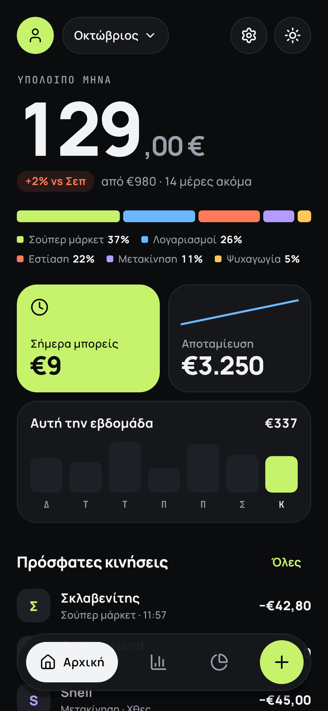
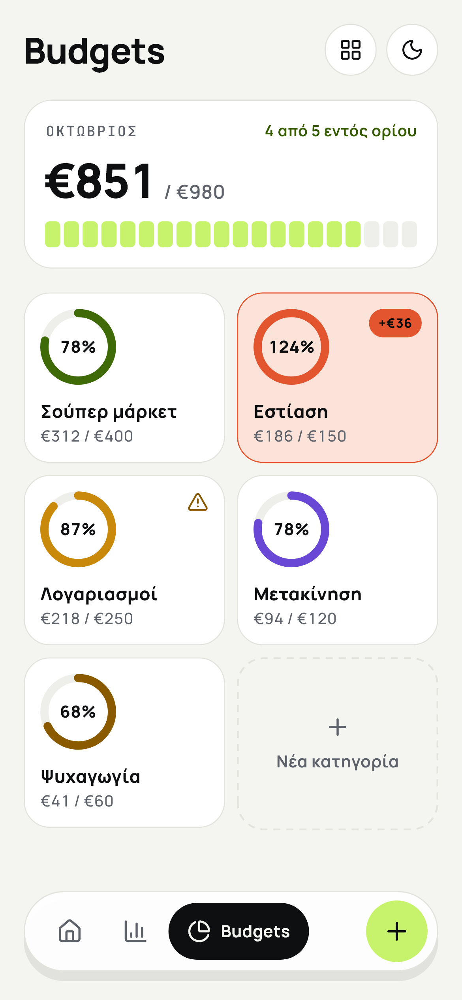
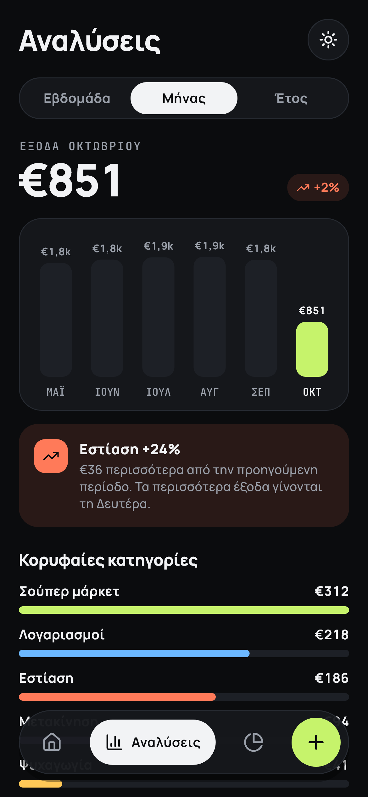
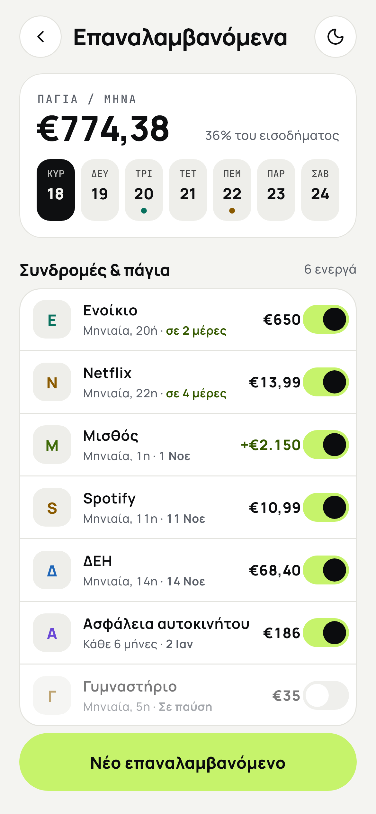
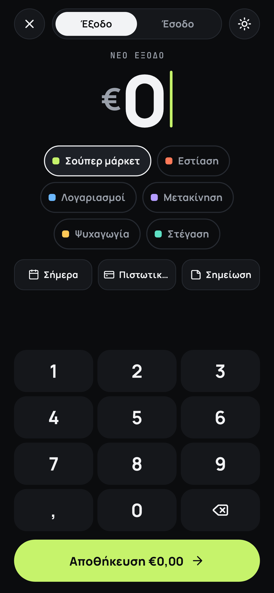
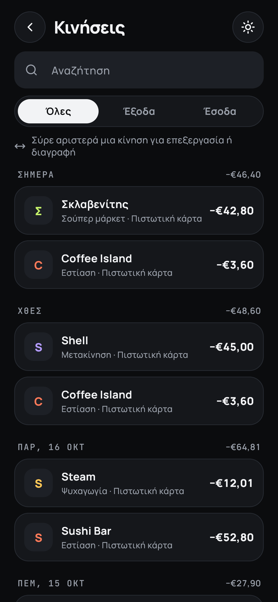
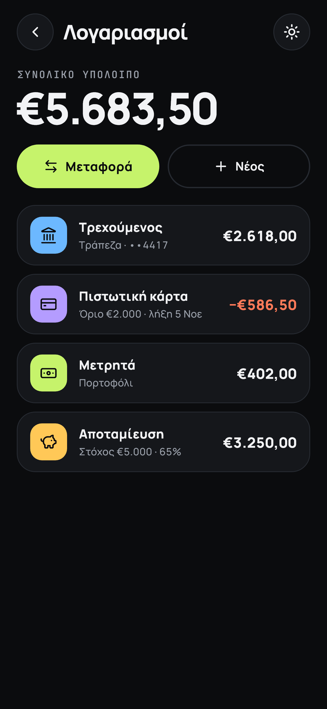
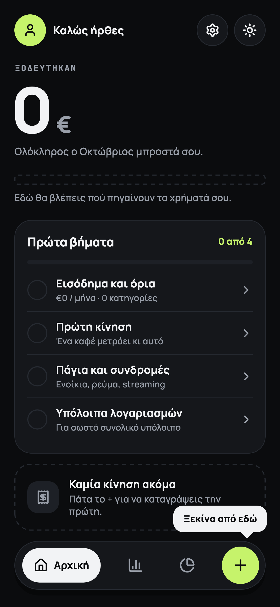

# Budget Pace

Offline-first personal budget app for iOS and Android. Greek UI (`el_GR`),
euros, dark by default.

| Αρχική | Budgets | Αναλύσεις | Επαναλαμβανόμενα |
|---|---|---|---|
|  |  |  |  |

| Νέα κίνηση | Κινήσεις | Λογαριασμοί | Πρώτη χρήση |
|---|---|---|---|
|  |  |  |  |

The screenshots are the golden tests, rendered with demo data.

## Setup

Requirements: **Flutter 3.47 (stable) / Dart 3.13**. Android needs the
Android SDK (API 24+); iOS needs Xcode and iOS 13+.

```sh
flutter pub get
flutter run
```

Generated code (`*.g.dart`, `*.freezed.dart`, the l10n classes) is committed,
so the app builds right after `pub get`. After changing models, tables,
providers or the ARB file, regenerate:

```sh
dart run build_runner build   # drift, freezed, json, riverpod
flutter gen-l10n              # also runs on pub get
```

### Demo data

```sh
flutter run --dart-define=SEED_DEMO=true
```

In **debug builds only**, and only on an empty database, this seeds six
months of realistic data relative to today: four accounts, budgets, recurring
rules and about 50 transactions a month. It also skips onboarding. To
re-seed, use Ρυθμίσεις › Επαναφορά δεδομένων and restart with the flag.

## Tests

```sh
flutter analyze
flutter test                              # everything (~170 tests)
flutter test --update-goldens --tags golden   # regenerate screenshots
```

- **Unit:** money parsing and formatting, budget periods (month ends, leap
  years), balances with transfers and credit cards, daily allowance,
  category thresholds, recurring materialisation (idempotency, paused,
  every N months), insights, CSV, backup round trip and import.
- **Integration:** every repository against an in-memory SQLite database,
  including the demo seed. Schema migrations are checked by the generated
  tests in `test/drift/` (schema shape and data integrity, v1 → v2).
- **Widget:** keypad rules, add expense → Home updates, swipe delete + undo,
  transfers, search, budgets and categories, recurring toggles, onboarding,
  biometric lock, reset.
- **Layout:** every screen and sheet at 360×640 and at text scale 1.3 with
  the real fonts must lay out without overflow.
- **Golden:** the main screens in dark and light.
- **Failure states:** a broken database shows "Κάτι πήγε στραβά" with a
  retry instead of a blank screen.

Widget tests run with *reduce motion* on and fail on any tap that would hit a
different widget than intended (`test/flutter_test_config.dart`).

## Architecture

```
lib/
  app/        App widget, router (go_router + StatefulShellRoute), startup, providers for prefs/theme
  core/       design system and shared code, no business rules
    theme/      PulseColors ThemeExtension, type scale, palette, keys
    money/      Money (int cents), keypad AmountInput
    period/     BudgetPeriod anchored on payday, date helpers
    widgets/    FloatingPillNav, HeroAmount, ProgressRing, SegmentedSpendBar, WeekBars,
                MoneyKeypad, SwipeableTxnTile, UndoSnackbar, PulseSwitch, sheets, …
    utils/      Greek text helpers, clock, context extensions
  domain/     pure business rules: balances, budget maths, recurring schedule, insights
  data/
    models/     freezed + json models (Account, TxnCategory, Txn, RecurringRule, AppSettings)
    db/         drift tables, DAOs, mappers, demo seed (schema snapshots in drift_schemas/)
    repositories/ interfaces + drift implementations
    prefs/      shared_preferences (theme, onboarding) and secure storage (lock flag)
    providers.dart  Riverpod providers for the database, repositories and shared streams
  features/   one folder per area: screens, sheets and their view models
  l10n/       app_el.arb (+ generated AppLocalizations)
```

**Data flow.** Screens never touch the database. Repositories expose drift
`watch` streams of domain models. Shared stream providers wrap them
(settings, accounts, categories, transactions in a date range, balances). Each
feature combines those into a view model (e.g. `homeVmProvider` →
`buildHomeVm(...)`), using the pure functions in `domain/`. Every number on
screen comes from the repositories; nothing is hard-coded.

**Money** is an `int` of cents end to end. `Money.format()` gives
`€1.057,70`, negatives use the true minus `−`. Parsing and the keypad cap
amounts at €99.999,99 with two decimals.

**Budget period.** The "month" runs from payday to payday (`BudgetPeriod`);
"available" = Σ category limits − spending in those categories; the daily
allowance divides what is left by the days remaining, today included.
Transfers never count as income or spending.

**Recurring.** On launch and on resume, every due occurrence becomes a real
transaction. A unique `(rule, date)` key makes this idempotent. Paused rules
are skipped, and resuming one does not back-fill.

**Deletes** are soft (`deletedAt`) with a 5-second undo; rows are purged after
7 days.

**Sync later.** Ids are client-generated UUIDs and every write goes through a
repository interface, so a Spring Boot sync layer can be added behind the
same interfaces without touching the UI.

### Adding a database migration

1. Change the tables in `lib/data/db/tables.dart` and bump `schemaVersion`.
2. `dart run drift_dev make-migrations`. It snapshots the new schema and
   generates step helpers and migration tests under `test/drift/`.
3. Add the step in `AppDatabase.migration.onUpgrade`, then run the tests.

### Adding English

Add `lib/l10n/app_en.arb` with the same keys. `supportedLocales` picks it up
automatically. Locale-sensitive helpers (`core/utils/greek.dart`, `Money`)
are the only other places that assume Greek.

## Design system

Colours live in `PulseColors` (a `ThemeExtension`, dark and light) and are
read with `context.colors`; widgets never hard-code a hex. Fonts are Manrope
and JetBrains Mono, bundled for offline use. All text meets 4.5:1 contrast
in both themes, which is why the light theme adds `coralInk` and `amberInk`
next to the spec's colours. State is never shown by colour alone, icon-only
buttons and charts have spoken labels, and text scales up to 1.3.

See [DECISIONS.md](DECISIONS.md) for the choices made where the spec was
silent or needed interpreting.

## License

Copyright © 2026 pavlostiftikidis. All rights reserved. The source is public
for viewing only; see [LICENSE](LICENSE). Fonts and packages keep their own
licences.
